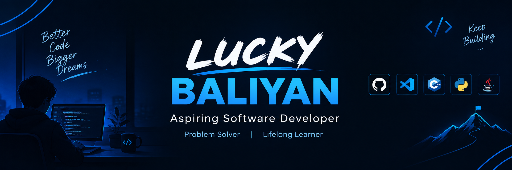

[+](url)

  

<!-- ========== HEADER ========== -->

  
  <h1>Hi 👋, I'm LUCKY BALIYAN</h1>
  <h3>Aspiring Software Developer | Problem Solver | Lifelong Learner</h3>

  

    
    
    
  

---

## 🚀 About Me

- 🎓 B.Tech student in Computer Science and Information Technology (CSIT).
- 💻 Learning to build useful projects and write clean, maintainable code.
- 🧠 Practicing Data Structures and Algorithms on LeetCode.
- 🌱 Continuously improving my programming and problem-solving skills.
- 🎯 Goal: Become a skilled software developer by learning and building consistently.

## 🛠️ Tech Stack

# 💻 Tech Stack

### 🔤 Languages

  
  
  

### 🎨 Frontend

  
  
  
  

### ⚙️ Backend

  
  
  
  

### 🗄️ Database & Cache

  
  

### 🚀 Deployment

  
  

### 🛠️ Tools & Version Control

  
  
  

<h2>🧠 Currently Exploring</h2>

  
  
  
  

<h2>🔄 Development Workflow</h2>

<table align="center">
  <tr>
    <td align="center"><b>💡 Idea</b></td>
    <td align="center"><b>📐 Architecture</b></td>
    <td align="center"><b>⚙️ Backend</b></td>
    <td align="center"><b>🔌 REST API</b></td>
  </tr>
  <tr>
    <td align="center"><b>🚀 Ship</b></td>
    <td align="center"><b>🌍 Deployment</b></td>
    <td align="center"><b>🎨 Frontend</b></td>
    <td align="center"><b>🗄️ Database</b></td>
  </tr>
</table>

  <b>From concept to production—every step matters.</b>

<h2>📌 Featured Projects</h2>

<table>
  <thead>
    <tr>
      <th>Project</th>
      <th>Technologies</th>
      <th>Description</th>
    </tr>
  </thead>
  <tbody>
    <tr>
      <td><b>E-Commerce Platform</b></td>
      <td>
        
        
        
        
        
      </td>
      <td>Full-stack ecommerce application with REST API backend, product management, category organization, and frontend/backend integration.</td>
    </tr>
    <tr>
      <td><b>CareerMind AI</b></td>
      <td>
        
        
        
        
      </td>
      <td>AI-focused career and developer learning platform combining intelligent recommendations with a modern web interface.</td>
    </tr>
    <tr>
      <td><b>FarmVaani</b></td>
      <td>
        
        
        
      </td>
      <td>AgriTech platform connecting farmers with real-time information and tools.</td>
    </tr>
    <tr>
      <td><b>FixMyArea</b></td>
      <td>
        
        
        
      </td>
      <td>Civic-tech initiative leveraging geolocation and AI for community problem-solving.</td>
    </tr>
  </tbody>
</table>

## 📊 GitHub Statistics

  
  

## 🔥 Contribution Streak

  

## 📈 Contribution Activity

  

## 💡 My Coding Journey

> "Great developers are built one problem, one project, and one day at a time."

Consistency matters more than perfection. Every problem I solve and every project I build helps me move one step closer to my goals.

## 🤝 Let's Connect

I'm always interested in learning, collaborating on projects, and connecting with fellow developers.

  <a href="https://github.com/luckyluckybaliyan-wq">GitHub</a> •
  <a href="https://www.linkedin.com/in/lucky-baliyan-491a44359?utm_source=share_via&utm_content=profile&utm_medium=member_android">LinkedIn</a> •
  <a href="https://leetcode.com/lucky1234512">LeetCode</a>

  

